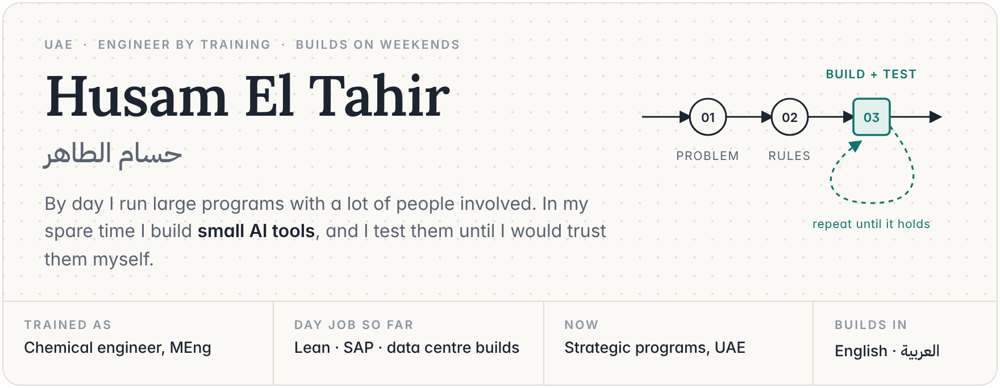
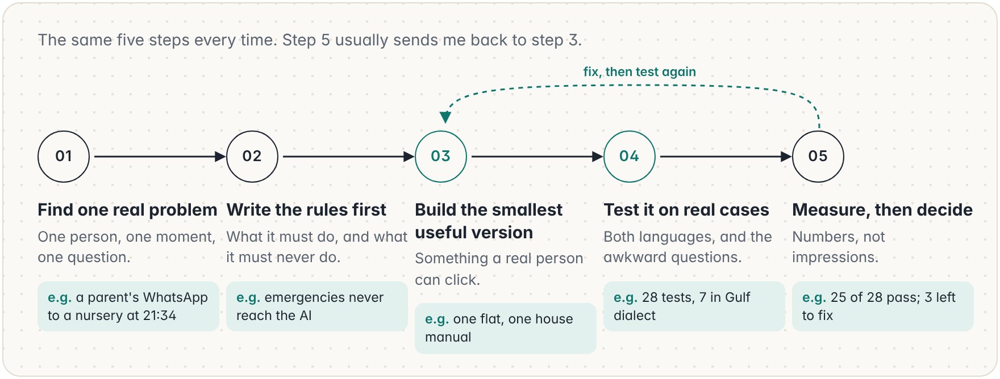
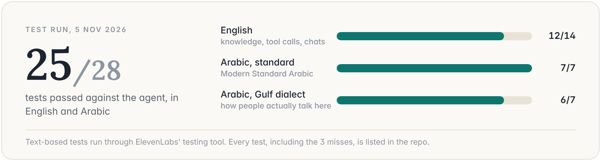
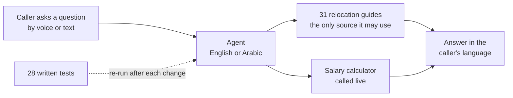
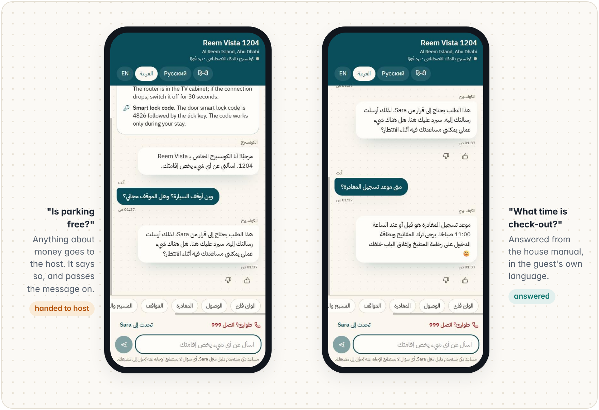
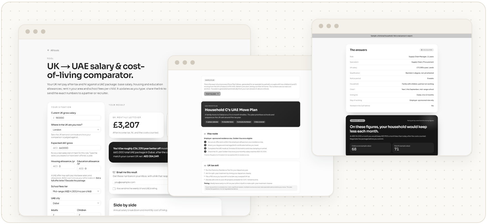
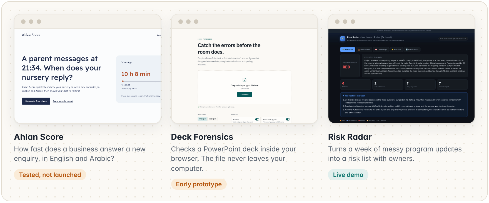
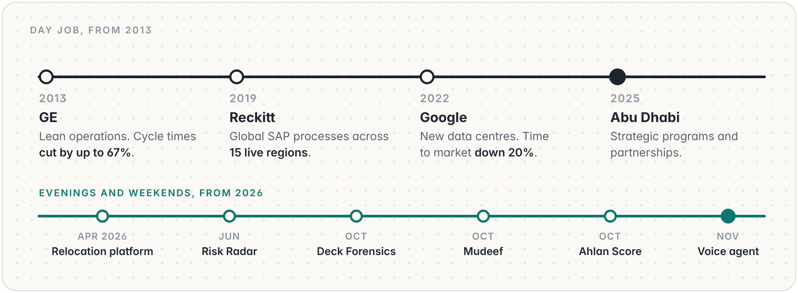

<picture>
  <source media="(prefers-color-scheme: dark)" srcset="assets/header-dark.png">
  
</picture>

 

I'm not a software engineer. I build with AI coding tools, and the part I bring is everything around the code: picking a problem worth solving, writing down the rules before anything gets built, and testing until it holds up. It's the same job I've done for over a decade on factory floors, SAP rollouts and data centre builds, just smaller and faster.

Half of what's below works in Arabic as well as English. In the Gulf, that isn't a nice extra.

## How a project goes

<picture>
  <source media="(prefers-color-scheme: dark)" srcset="assets/build-dark.png">
  
</picture>

## Things I've built

### A voice agent that answers in English and Arabic

<picture>
  <source media="(prefers-color-scheme: dark)" srcset="assets/voice-dark.png">
  
</picture>

- Answers questions about moving from the UK to the UAE using only one website's own guides, and runs a live salary comparison when someone asks how much better off they'd be.
- The whole agent is defined in a few config files, so every change can be reviewed, rolled back and tested again.
- 28 written tests, half of them in Arabic, that I can re-run after any change. Some are in Gulf dialect, because that's how people actually talk here.

**[Code and full test results](https://github.com/husameltahir/bilingual-voice-agent)** · built on ElevenLabs · November 2026

How it fits together

 

### Mudeef, a house-manual concierge for holiday homes

<picture>
  <source media="(prefers-color-scheme: dark)" srcset="assets/mudeef-dark.png">
  
</picture>

*Mudeef (مضيف) is Arabic for host.*

- A host uploads the house manual once. Guests open a link or scan a QR code and ask anything, in English, Arabic, Russian or Hindi.
- It answers only from the manual. If the answer isn't there, it says so and passes the question to the host.
- Refunds, complaints and anything about money are handed to the host. Emergency words are caught before the AI sees the message, and the reply is always the same fixed text with 999, 998 and 997.

**[Try the demo](https://mudeef-concierge-uae.lovable.app/demo)** · a made-up flat in Abu Dhabi, any of the four languages

### A relocation platform for people moving from the UK to the UAE

<picture>
  <source media="(prefers-color-scheme: dark)" srcset="assets/reloc-dark.png">
  
</picture>

- Works out whether a UAE offer leaves a household better off once rent, school fees and the move itself are paid for, then plans the move step by step.
- More than 20 tools and 31 guides. Figures on the site carry a dated source, and anything without one gets removed.
- My longest build: started in April 2026, more than 200 small releases since. Live in open beta; I'm happy to share the link.

**[Case study](https://github.com/husameltahir/relocation-platform-case-study)**

### Smaller builds

<picture>
  <source media="(prefers-color-scheme: dark)" srcset="assets/small-dark.png">
  
</picture>

- **Ahlan Score.** With the owner's consent, it sends test enquiries by WhatsApp, Instagram, web form, phone and email, then scores how fast and how well the business replies, including whether it answers in Arabic. The result is a short bilingual report. Built and tested on sample data; no live audits yet.
- **Deck Forensics.** Drop in a PowerPoint deck and it lists every font, colour and figure. It runs in your browser, so the file never leaves your computer. Next on the list: totals that don't add up, and figures that disagree between slides.
- **Risk Radar.** Turns a week of program updates from chat threads, stand-ups and vendor emails into a risk list, with an owner and a source for every item. [Live demo](https://husameltahir.github.io/risk-radar/) · [code](https://github.com/husameltahir/risk-radar)

## Background

<picture>
  <source media="(prefers-color-scheme: dark)" srcset="assets/career-dark.png">
  
</picture>

The side projects use the same habits as the day job: agree what good looks like before starting, make it repeatable, then measure it.

## Get in touch

[LinkedIn](https://www.linkedin.com/in/husam-eltahir/) is the best way to reach me. I'm always happy to compare notes with people putting AI in front of real customers, especially in Arabic.

The screens above come from working demos with made-up data. Last updated November 2026.
